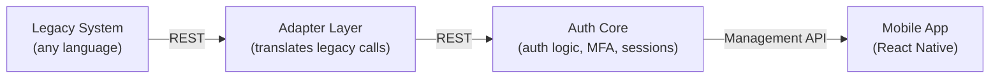

# Latchpoint

A containerised, API-first authentication framework that small businesses can attach to existing (including legacy) systems without rebuilding their codebase. Managed and monitored via a mobile app.

Final year capstone project (Eduvos).

## The Problem

Small businesses often run web applications with weak or poorly implemented authentication, but lack the budget or expertise to build secure auth systems in-house. Existing solutions are either too complex, too costly, or not designed for small-scale, resource-constrained environments.

## The Solution

Latchpoint is a standalone authentication service that businesses attach to their existing system rather than build themselves. Legacy systems integrate via a REST API, so the framework works regardless of what language the business's existing application is written in. The whole thing ships as Docker containers for consistent, dependency-free deployment on the business's own server, and is monitored/configured remotely via a mobile app.

**Two problems, two solutions — not one:**

- **Cross-language integration** → solved by exposing a REST API (any language can make an HTTP call)
- **Consistent, dependency-free deployment** → solved by Docker

## Architecture



- **`auth-core`** — the authentication service. Handles credential verification, MFA, session management, and password policy enforcement. Exposes a REST API.
- **`adapter-layer`** — sits in front of Auth Core for legacy systems that can't make REST calls natively; translates their requests into calls Auth Core understands.
- **`mobile-app`** — talks only to the Management API (part of Auth Core's REST API). Lets a business owner monitor auth events and configure settings (MFA, password policy, session timeout) remotely.
- **`docker-compose.yml`** — spins up `auth-core` and `adapter-layer` together for local development or deployment on a business's own server.

## Tech Stack

| Component | Tech |
| --- | --- |
| Auth Core / API | Java, Spring Boot, Spring Security |
| Database | MySQL |
| MFA | TOTP library (e.g. `java-totp` / Google Authenticator-compatible) |
| Adapter Layer | Java (Spring Boot) |
| Mobile App | React Native |
| Deployment | Docker, Docker Compose |

## Deployment Model

Self-hosted: each business runs their own container(s) on their own server, alongside their existing system. Latchpoint is *positioned* as a SaaS-style product (buy it, attach it, done) but is not a multi-tenant cloud service — no shared infrastructure or cross-business data.

## Getting Started

Requires Git, Docker and Docker Compose.

```bash
git clone https://github.com/JeffyJ080/latchpoint.git
cd latchpoint
cp .env.example .env
```

On Windows PowerShell, use `Copy-Item .env.example .env` instead of `cp`.

Review `.env`, then start the backend and demonstration application:

```bash
docker compose up -d --build
docker compose ps
```

The stack contains MySQL, Auth Core, Adapter Layer and the demonstration
legacy application.

Default addresses:

- Auth Core health: <http://localhost:8080/actuator/health>
- Adapter health: <http://localhost:8081/actuator/health>
- Legacy application: <http://localhost:8082>

Use the host ports configured in `.env`. For example,
`AUTH_CORE_PORT=8085` makes Auth Core available at
<http://localhost:8085> while its container continues using port 8080.

Development accounts created on a fresh database:

| Username | Password | Role |
| --- | --- | --- |
| admin | Admin123! | ADMIN |
| demo_user | UserPassword123! | END_USER |

These accounts are for local demonstration. Neither has MFA enrolled initially.
SQL initialization runs only when the database volume is first created.

See [Development Setup](docs/Dev%20Setup.md) and
[API Contract](docs/Api%20contract.md) for configuration and endpoint details.

## Project Structure

```
latchpoint/
├── auth-core/          # Java/Spring Boot authentication service (REST API)
├── adapter-layer/       # Translates legacy system calls into REST requests
├── mobile-app/          # React Native app for monitoring & configuration
├── docker-compose.yml   # Local/self-hosted deployment
├── docs/                # Architecture notes, research documentation
├── LICENSE
└── README.md
```

## Research Context

This project supports research into secure authentication for small business web applications, including:

- Common authentication vulnerabilities and how they expose data to risk
- Comparison of modern vs. traditional authentication techniques
- Effective prevention methods for authentication-related attacks
- Practical, cost-effective implementation of a secure authentication framework for small businesses, including integration with legacy systems
- Evaluation of implemented security measures against real-world attacks

## Team

- Neo Brian Bampoe
- Christiaan Coetzee
- Boikanyo Setati

## License

MIT — see [LICENSE](./LICENSE).
